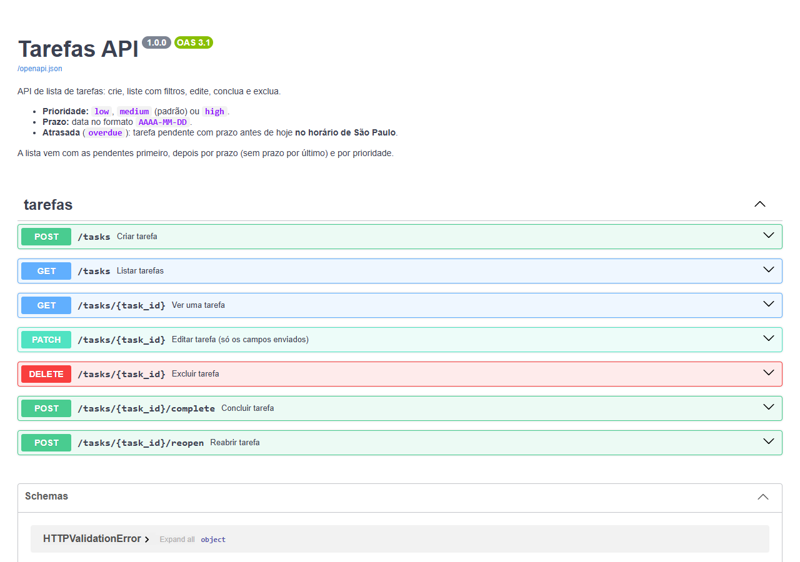

# Tarefas API

[](https://github.com/thenrynadai-oss/tarefas-api/actions/workflows/ci.yml)

API de **lista de tarefas** em **Python** com **FastAPI** e **SQLite**: criar, listar com filtros, editar, concluir, reabrir e excluir. A documentação interativa sai pronta em `/docs`.



## De onde veio

Fiz uma lista de tarefas no primeiro ano de Engenharia de Software na ENIAC (2026). O original não foi versionado. Esta versão foi reescrita por mim em outubro de 2026, com ajuda do Claude Code, e virou uma API com banco de dados e testes automatizados.

## Rotas

| Método | Rota | O que faz |
|---|---|---|
| `POST` | `/tasks` | Cria uma tarefa |
| `GET` | `/tasks` | Lista, com filtros `status`, `priority`, `due_until` e `overdue` |
| `GET` | `/tasks/{id}` | Mostra uma tarefa |
| `PATCH` | `/tasks/{id}` | Edita só os campos enviados |
| `POST` | `/tasks/{id}/complete` | Marca como concluída |
| `POST` | `/tasks/{id}/reopen` | Reabre |
| `DELETE` | `/tasks/{id}` | Exclui |

Exemplo:

```bash
curl -X POST http://127.0.0.1:8000/tasks \
  -H "Content-Type: application/json" \
  -d '{"title": "Entregar o trabalho de POO", "priority": "high", "due_date": "2026-10-15"}'
```

## Decisões

- **SQL escrito à mão** com `sqlite3`, sem ORM, para o SQL ficar à vista. Todo valor vai por parâmetro (`?`); os nomes de coluna do `PATCH` saem de uma lista fixa no código, nunca do que o cliente manda.
- **"Atrasada" segue o dia de São Paulo**, não o do servidor. Um único lugar decide o dia (`app/clock.py`), com o banco de fusos `tzdata`. Os testes rodam às 22h30 de São Paulo, quando em UTC já é o dia seguinte. Há também um teste que falha se aparecer offset fixo ou soma de 24 horas no código.
- **Relógio injetável.** O `create_app` recebe o caminho do banco e uma função que diz que horas são. Assim, cada teste usa um banco temporário e uma hora fixa.
- **`PATCH` de verdade.** Só muda o que foi enviado. `due_date: null` apaga o prazo, e `title: null` é recusado.
- **Ordem útil.** A lista traz as pendentes primeiro, depois por prazo (sem prazo por último) e por prioridade.

## Rodar na sua máquina

Precisa do Python 3.12 ou mais novo.

```bash
python -m venv .venv
source .venv/bin/activate        # no Windows: .venv\Scripts\activate
pip install -e ".[dev]"
uvicorn app.main:app --reload
```

Abra http://127.0.0.1:8000/docs. Os dados ficam em `tarefas.db`; para outro arquivo, defina `TAREFAS_DB`.

## Testes

```bash
pytest
```

## Licença

MIT
